# AgriPheno : dix images RGB réelles de drone

## Objectif et protocole

Ce rapport décrit un échantillon pédagogique choisi pour une démonstration d'entretien, pas un benchmark représentatif. Les images viennent de photographies RGB de drone ; aucune image satellite, terrestre, artificielle ou composition multispectrale n'est utilisée. Les tuiles ne représentent pas nécessairement une parcelle entière. La sélection a été effectuée dans l'ordre des identifiants, avant tout examen des scores. Le catalogue permet d'identifier chaque photographie source ; des vues d'un même vol restent corrélées et ne sont pas dix essais indépendants.

Le calcul est exactement celui de Streamlit (`src.analysis`) : conversion RGB documentée ; S=R+G+B ; r=R/S, g=G/S, b=B/S ; ExG=2g−r−b ; végétation si ExG>0,10. Le nettoyage morphologique est désactivé pour tous les résultats principaux. Les pixels exactement noirs sont exclus de la couverture et de l'évaluation. Les pixels sombres non noirs restent valides. La couverture est le pourcentage de pixels valides classés végétation.

IoU=TP/(TP+FP+FN) et F1=2TP/(2TP+FP+FN), calculés sur la même zone valide, uniquement avec une référence de végétation compatible et vérifiée. Les deux métriques sont indéfinies si les deux masques sont vides. Les annotations d'adventices seules ou les boîtes ne constituent pas une vérité terrain de végétation totale. Une référence fournie peut être imparfaite : une inspection visuelle ne prouve pas son exactitude agronomique ni son indépendance.

## Sources et réutilisation

- [CoFly-WeedDB](https://zenodo.org/records/6697343) — Marios Krestenitis; Emmanuel K. Raptis; Athanasios Ch. Kapoutsis; Konstantinos Ioannidis; Elias B. Kosmatopoulos; Stefanos Vrochidis; Ioannis Kompatsiaris. DJI Phantom 4 Pro. Licence [CC BY 4.0](https://creativecommons.org/licenses/by/4.0/). Attribution obligatoire, transformations indiquées dans le catalogue.
- [High-Resolution RGB Images and Corresponding Masks of Agricultural Fields](https://zenodo.org/records/12607112) — Canistro, Federico; De Marinis, Pasquale; Vessio, Gennaro; Castellano, Giovanna. DJI Air 2S. Licence [CC BY 4.0](https://creativecommons.org/licenses/by/4.0/). Attribution obligatoire, transformations indiquées dans le catalogue.
- [USU-Corn-WeedDB](https://zenodo.org/records/20044178) — Bhandari, Utsav; Etienne, Aaron. Autel EVO II Dual 640T V2. Licence [CC BY 4.0](https://creativecommons.org/licenses/by/4.0/). Attribution obligatoire, transformations indiquées dans le catalogue.

Les licences sont vérifiées depuis les métadonnées des dépôts, conservées dans `data/provenance/`. Le catalogue `data/sources.csv` contient les auteurs, DOI, URLs exactes, membres ZIP, date HTTP d'accès, SHA-256 des fichiers source et préparés, dimensions, conversions et commentaires de revue. Les archives originales et les blocs HTTP sont conservés dans un cache local ignoré par Git. Les membres sont extraits sélectivement avec validation HTTP Range et CRC ZIP.

## Résultats observés

Paramètres communs : seuil 0,10 ; aucune morphologie ; aucune optimisation sur les références. Les couvertures sont des pourcentages ; l'erreur de couverture est en points de pourcentage, signée prédiction moins référence. IoU et F1 sont des fractions entre 0 et 1. Un tiret indique une métrique absente ou indéfinie. Les décimales sont des résultats numériques, pas une garantie de précision scientifique.

**Aucune des dix images ne dispose d'une référence validée de végétation totale. Aucun score IoU/F1 terrain n'est donc publié pour ce jeu.** Les masques fournis ont été examinés ; leur présence dans un dépôt ne garantit pas qu'ils annotent la cible recherchée.

| image_id | couverture_pct | couverture_reference_pct | erreur_couverture_pp | iou | f1 | evaluation |
| --- | --- | --- | --- | --- | --- | --- |
| cofly_01 | 46.435 | — | — | — | — | REFERENCE_NON_COMPATIBLE_OU_NON_VERIFIEE |
| cofly_02 | 56.947 | — | — | — | — | REFERENCE_NON_COMPATIBLE_OU_NON_VERIFIEE |
| cofly_03 | 45.495 | — | — | — | — | REFERENCE_NON_COMPATIBLE_OU_NON_VERIFIEE |
| corn_01 | 35.165 | — | — | — | — | REFERENCE_NON_COMPATIBLE_OU_NON_VERIFIEE |
| corn_02 | 49.629 | — | — | — | — | REFERENCE_NON_COMPATIBLE_OU_NON_VERIFIEE |
| corn_03 | 17.214 | — | — | — | — | REFERENCE_NON_COMPATIBLE_OU_NON_VERIFIEE |
| corn_04 | 27.107 | — | — | — | — | REFERENCE_NON_COMPATIBLE_OU_NON_VERIFIEE |
| agri_c0 | 12.575 | — | — | — | — | REFERENCE_NON_COMPATIBLE_OU_NON_VERIFIEE |
| agri_c108 | 13.715 | — | — | — | — | REFERENCE_NON_COMPATIBLE_OU_NON_VERIFIEE |
| agri_c217 | 14.451 | — | — | — | — | REFERENCE_NON_COMPATIBLE_OU_NON_VERIFIEE |

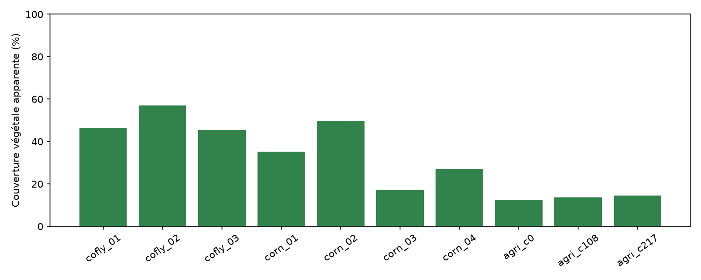

Les résultats complets sont dans [le CSV](../data/results/real_drone_results.csv). La [sensibilité au seuil](../data/results/real_drone_thresholds.csv) compare 0,00, 0,10 et 0,20, avec tous les autres paramètres fixes : elle montre la dépendance au réglage sans choisir un seuil gagnant. Les résultats recalculés dans Streamlit peuvent différer si l'utilisateur change les paramètres.

## Revue visuelle par image

Les descriptions ci-dessous sont des observations humaines sur ce jeu installé. Les mentions de couleur, sol et ombre ne sont pas des diagnostics d'espèce, de maladie ou de stress.

### cofly_01

Rangs de cotonnier rapprochés, inter-rangs de sol clair, bandes d'ombre et lignes d'irrigation sombres. Quelques zones centrales ont une teinte plus pâle ou brunâtre ; leur cause n'est pas déterminée. Le cadrage contient culture et végétation d'inter-rang, que le seul ExG ne distingue pas. À 0,10, le masque suit visuellement les rangs verts ; les zones centrales pâles sont moins reprises, et quelques réponses isolées dans les inter-rangs demanderaient une annotation pour être interprétées.

Transformation : RGB uint8 conservé; aucune réduction. Annotations : adventices_uniquement. Les annotations de la source ne couvrent que trois classes d'adventices ; le cotonnier n'est pas annoté comme végétation. Elles sont conservées mais exclues de l'IoU/F1 de végétation totale.

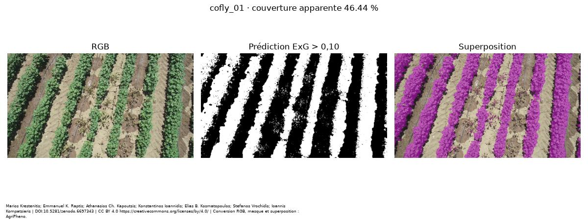

### cofly_02

Rangs diagonaux de cotonnier, sol clair visible entre les rangs et ombres sur les côtés des couverts. Le couvert est assez régulier, avec une interruption visible dans un rang à droite. Lignes d'irrigation sombres visibles ; aucune conclusion sur l'état des plantes. À 0,10, le masque reprend les bandes vertes des rangs et leur interruption visible ; cette cohérence visuelle n'est pas un score de précision.

Transformation : RGB uint8 conservé; aucune réduction. Annotations : adventices_uniquement. Annotations d'adventices uniquement : absence d'une référence de végétation totale, donc pas de score IoU/F1.

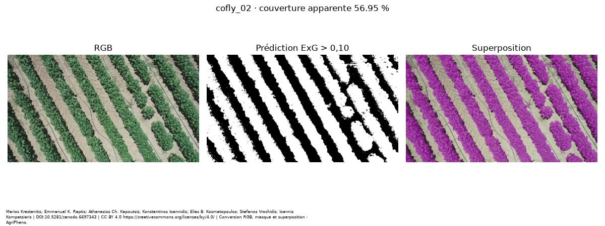

### cofly_03

Vue proche de rangs de cotonnier avec grandes feuilles vertes, inter-rangs de sol sec craquelé et ombres nettes. Une ombre en bas à droite présente une silhouette compatible avec le drone ; cette interprétation reste visuelle. Le cadrage et l'échelle diffèrent des deux autres vues du même champ. À 0,10, les grandes zones feuillées sont reprises et les inter-rangs restent majoritairement non sélectionnés. Les limites des petites feuilles et les zones d'ombre restent à contrôler.

Transformation : RGB uint8 conservé; aucune réduction. Annotations : adventices_uniquement. Annotations d'adventices uniquement ; elles ne servent pas à noter la segmentation de l'ensemble du couvert.

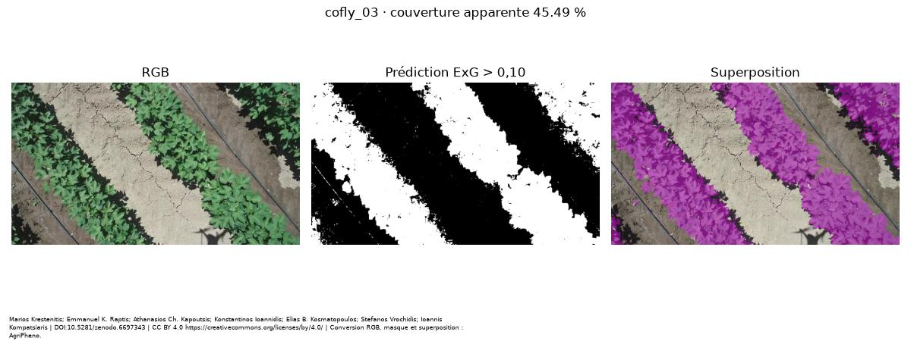

### corn_01

Tuile de maïs avec de longues feuilles vertes, certaines portions plus claires ou jaunâtres, beaucoup de sol apparent et des ombres portées très foncées. Les extrémités fines et les pixels de bord feuille/sol constituent des cas difficiles à inspecter. Aucune cause physiologique n'est inférée de la couleur. La superposition à 0,10 suit de nombreuses feuilles, mais présente aussi des réponses ponctuelles sur le fond apparent ; leur nature n'est pas vérifiée par une annotation complète.

Transformation : RGB uint8 conservé; aucune réduction. Annotations : boites_adventices. La source fournit des boîtes de détection d'adventices, pas des masques pixel à pixel de végétation totale. Aucun remplissage de boîte ne sert de référence.

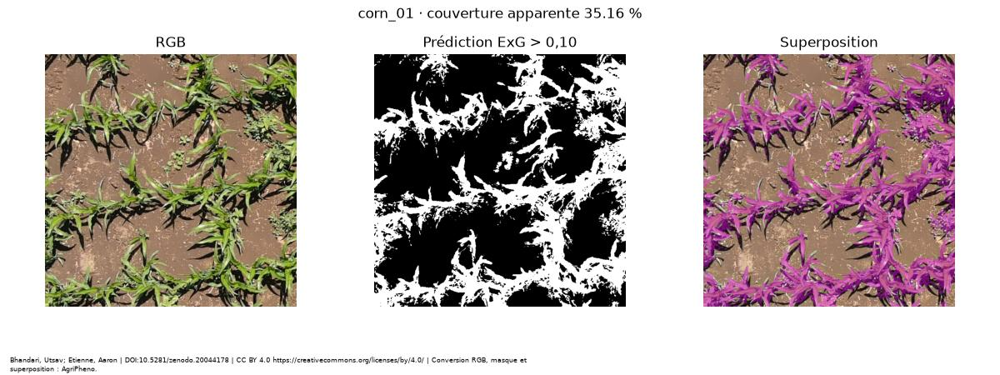

### corn_02

Tuile de maïs où plusieurs feuilles se recouvrent, avec des zones vertes et plus pâles, un fond brun et des ombres marquées au centre. Le recouvrement masque les organes inférieurs. Le seul ExG ne permet pas d'identifier les adventices ni de diagnostiquer les teintes pâles. Le masque à 0,10 reprend les groupes de feuilles et forme de nombreuses petites composantes ; leur présence ne permet pas de compter des plantes ni d'identifier des adventices.

Transformation : RGB uint8 conservé; aucune réduction. Annotations : boites_adventices. Boîtes d'adventices uniquement ; aucune évaluation IoU/F1 de végétation totale.

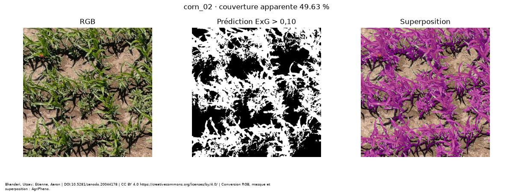

### corn_03

Tuile de maïs présentant une grande proportion de sol nu, des feuilles étroites vert clair à jaunâtres et des ombres tranchées. Les tissus de faible contraste avec le sol risquent d'être omis selon le seuil ; cette difficulté est à examiner sur la superposition, sans diagnostic de stress. À 0,10, certaines extrémités ou portions très claires visibles ne sont pas colorées dans la superposition. Une annotation indépendante serait nécessaire pour quantifier ces omissions.

Transformation : RGB uint8 conservé; aucune réduction. Annotations : boites_adventices. La présence de boîtes dans la source ne constitue pas une annotation de végétation totale.

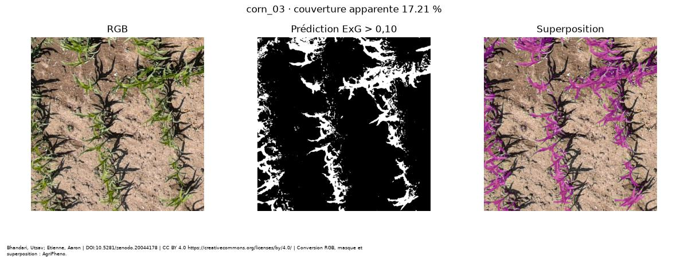

### corn_04

Tuile de maïs avec un groupe de feuilles chevauchantes en haut, un sol brun clair dominant en bas et de longues ombres. Des portions de feuilles ont une teinte plus claire. Les différences de couverture avec une autre tuile peuvent provenir du cadrage ; elles ne prouvent pas une différence de croissance. Le masque à 0,10 suit les longues feuilles, tandis que les détails fins sont parfois discontinus et que les ombres restent largement non sélectionnées.

Transformation : RGB uint8 conservé; aucune réduction. Annotations : boites_adventices. Boîtes de détection uniquement ; pas de référence compatible avec la végétation totale.

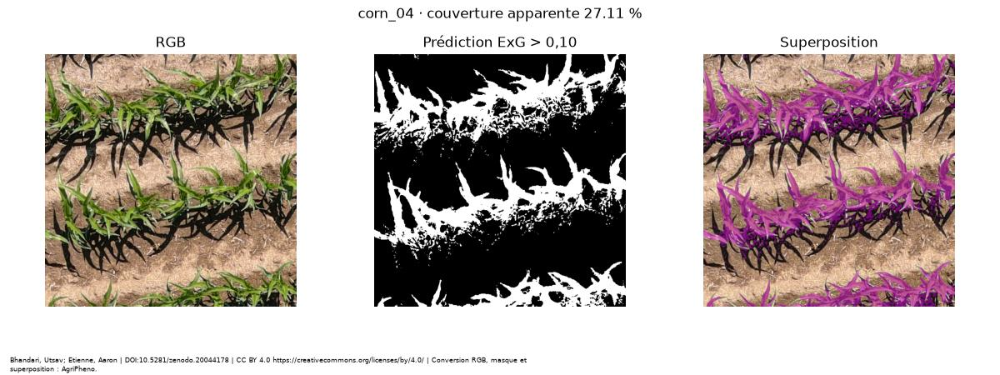

### agri_c0

GeoTIFF photographique livré par le dépôt, avec bordures noires obliques, rangs de petites structures végétales et de supports sur un sol largement apparent, et une zone arborée à droite. La culture n'est pas identifiée au niveau image dans le dépôt. Les bordures noires sont exclues du calcul. À 0,10, les réponses sont éparses entre les rangs et plus concentrées à droite ; certaines zones de fond apparemment nu sont également colorées. Ce résultat ne peut pas être interprété comme une mesure validée du couvert.

Transformation : uint16 /257 puis arrondi uint8, échelle commune RGB; aucune réduction. Annotations : masque_non_vegetation_emprise_presumee. Le masque m0 est binaire 0/255 et a les mêmes dimensions que l'image, mais il est blanc sur le sol nu comme sur la végétation et suit l'emprise du cadrage. Hypothèse d'un masque d'emprise/validité, non confirmée par les auteurs. Il est incompatible avec une référence de végétation totale et n'est utilisé ni pour l'IoU/F1 ni comme vérité terrain construite par ExG.

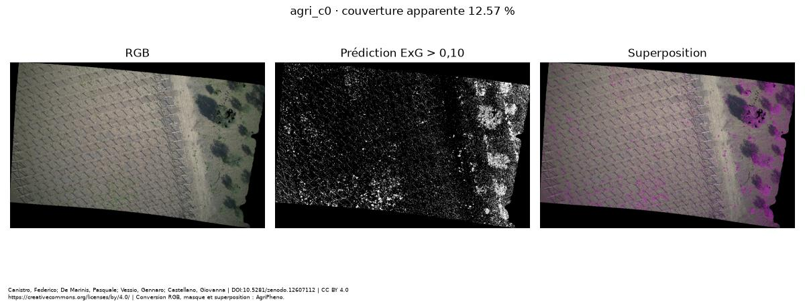

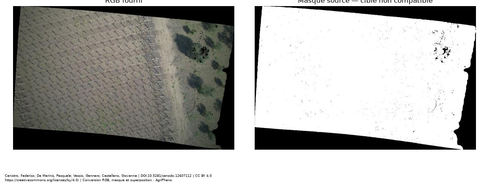

### agri_c108

GeoTIFF photographique avec rangs espacés de petites structures végétales et supports sur un fond largement brun-gris, ainsi que des zones noires sur les bordures et à droite. La culture exacte n'est pas fournie au niveau image. Les très petites structures, les teintes ternes et les zones sombres rendent l'interprétation d'une simple séparation vert/sol délicate. À 0,10, le masque est très morcelé et présente des réponses diffuses sur des zones de fond apparemment nu. L'estimation est particulièrement sensible au seuil et ne doit pas être assimilée à une segmentation validée des petites structures végétales.

Transformation : uint16 /257 puis arrondi uint8, échelle commune RGB; aucune réduction. Annotations : masque_non_vegetation_emprise_presumee. m108 est binaire 0/255 et ses dimensions correspondent au RGB, mais il reste blanc sur les grandes surfaces de sol entre les rangs. Ses contours suivent l'emprise et les trous noirs. L'interprétation comme masque d'emprise/validité est une hypothèse visuelle, non une confirmation des auteurs. Il ne constitue pas une référence de végétation totale ; aucun IoU/F1 n'est calculé contre lui.

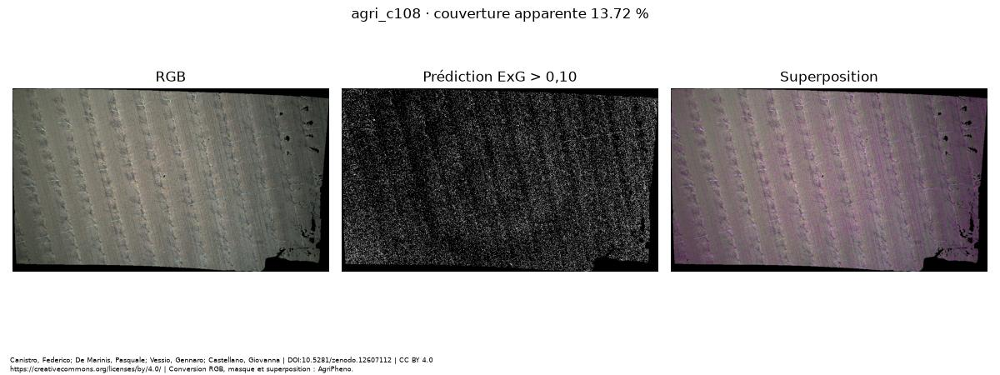

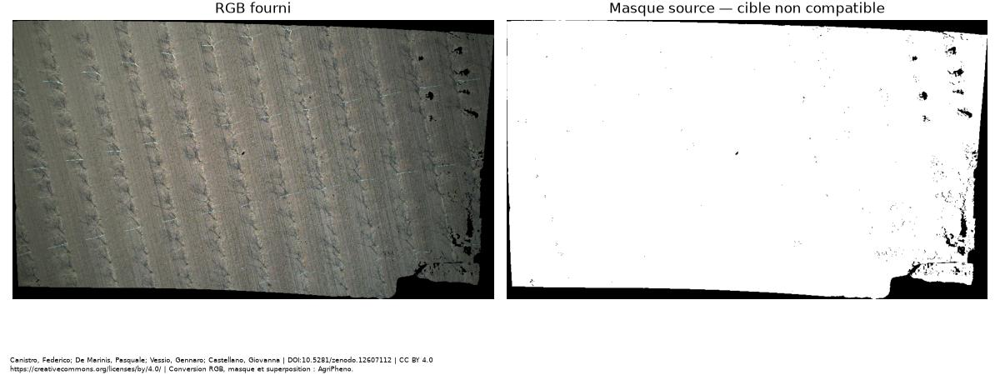

### agri_c217

GeoTIFF photographique d'une zone arborée, avec couronnes vertes séparées, sol brun apparent, longues ombres portées et trous noirs à l'intérieur de certaines couronnes. L'espèce cultivée n'est pas confirmée au niveau image. Les pixels noirs sont exclus, ce qui peut faire varier le dénominateur autour des couronnes ; l'indice ne décrit pas le volume des arbres. À 0,10, les couronnes visibles ne sont pas reprises uniformément et des réponses apparaissent aussi entre les arbres. L'estimation de 14,45 % montre les limites de ce réglage sur cette scène ; aucune exactitude du couvert arboré n'est revendiquée.

Transformation : uint16 /257 puis arrondi uint8, échelle commune RGB; aucune réduction. Annotations : masque_non_vegetation_emprise_presumee. m217 est binaire 0/255, aligné en dimensions, et blanc sur une très grande partie du sol comme sur la végétation ; il est aussi noir sur des trous et bordures. Il ne sépare pas végétation et sol. L'hypothèse emprise/validité reste une interprétation visuelle, non confirmée par les auteurs ; aucune IoU/F1 de végétation totale n'est publiée.

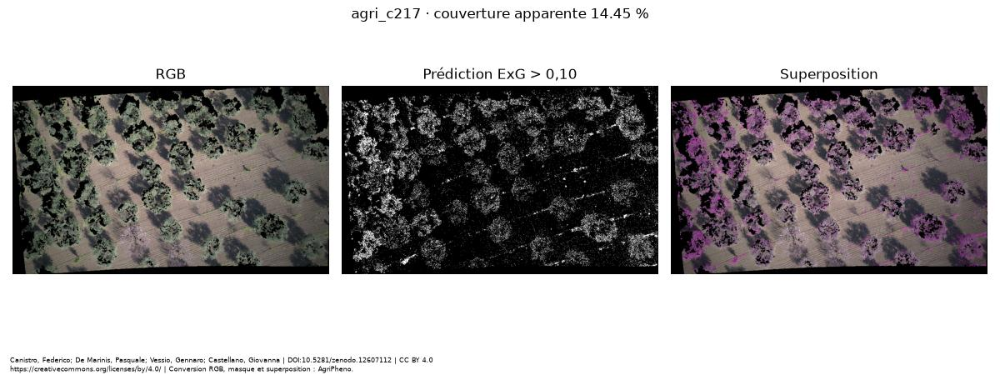

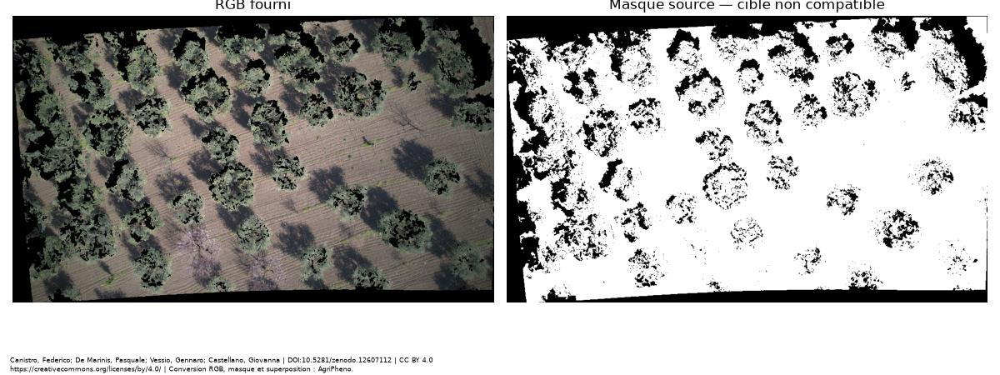

## Limites et améliorations

- ExG sépare des couleurs, sans reconnaître les cultures : végétation cultivée et adventices peuvent toutes deux être incluses ; des objets ou sols verdâtres peuvent créer des faux positifs. Les feuilles pâles, jaunies, desséchées et certains pixels d'ombre peuvent être manqués.
- La normalisation réduit l'effet d'un facteur lumineux identique sur RGB. Elle ne corrige pas une balance des blancs variable, les ombres colorées, le sol humide, les saturations ou la compression. Un seuil n'est pas universel.
- La morphologie peut supprimer de petites feuilles et combler des espaces. Son noyau est en pixels : la résolution physique et la hauteur de vol doivent être prises en compte avant une comparaison entre acquisitions.
- Exclure les pixels noirs ne résout pas l'ombre. La vue, le cadrage, l'échelle, la présence d'inter-rangs et les organes masqués influencent la couverture. Des images de plusieurs capteurs ne sont pas radiométriquement interchangeables.
- La couverture apparente n'est une mesure directe ni de biomasse, ni de rendement, ni de LAI, ni de stress hydrique. Les observations de couleur ne permettent pas de conclure à une carence ou un stress.
- Une amélioration RGB serait une annotation indépendante avec un protocole clair, des régions d'intérêt de parcelles, une maîtrise de l'acquisition, puis une validation sur des champs et dates distincts. Des méthodes adaptatives de seuillage ou un modèle appris pourraient ensuite être comparés sur un jeu réservé.
- Un capteur multispectral disposant de rouge et de proche infrarouge permettrait NDVI=(NIR−R)/(NIR+R), après alignement des bandes et calibration radiométrique en réflectance, avec gestion du dénominateur nul. Le NDVI n'est jamais calculé ici. Il peut fournir une information complémentaire, mais reste sensible au sol et peut saturer sur les couverts denses ; il ne donne pas directement un diagnostic de stress, de rendement ou de LAI sans validation spécifique.

Références pour cette extension : [définition du NDVI, USGS](https://www.usgs.gov/landsat-missions/landsat-normalized-difference-vegetation-index) ; [sensibilité au sol et saturation, USGS](https://www.usgs.gov/special-topics/remote-sensing-phenology/science/ndvi-foundation-remote-sensing-phenology). Ces pages expliquent l'indice ; aucune image satellitaire de ces sources n'est intégrée au jeu AgriPheno.

## Expliquer le code à l'entretien

1. `scripts.acquire_real_images` télécharge seulement les membres nécessaires des ZIP, contrôle la licence et conserve la provenance. La conversion en PNG prépare les photos sans inventer de contenu.
2. `src.segmentation` convertit les canaux en flottants, normalise RGB, calcule ExG et applique le seuil. La morphologie optionnelle agit sur le masque binaire.
3. `src.analysis` appelle ce moteur, compte les pixels, produit les contrôles qualité et autorise ou refuse les références selon leur cible. `src.metrics` calcule couverture, IoU et F1.
4. `src.ui` affiche ces résultats et les exporte. Le même pipeline alimente ce rapport : il n'existe pas de deuxième formule de couverture réservée à la démonstration.
5. Pour commenter un résultat : montrer le cadrage et le masque, annoncer les paramètres et la couverture, examiner les faux positifs/négatifs visibles puis expliquer ce que les annotations permettent réellement de vérifier.

## Reproduire hors ligne

Depuis la racine : `python -m scripts.build_real_report`, puis `python -m streamlit run app.py`. Les fichiers préparés, leurs références et le catalogue suffisent ; le rapport et l'application n'accèdent pas au réseau. Pour réacquérir les originaux, utiliser `python -m scripts.acquire_real_images` avec Internet. Les tests automatiques utilisent des réponses réseau simulées.

## Vérification logicielle

Recette du 2026-11-12 : 57 tests réussis. Aucune dépendance incompatible. AppTest sur les dix images installées avec urllib et requests bloqués : résultats identiques au CSV à 0,000001 près ; sélection de deux images et inspection de agri_c217 réussies. AppTest ne remplace pas une validation complète dans un navigateur. Les tests logiciels ne valident pas une performance agronomique terrain.
